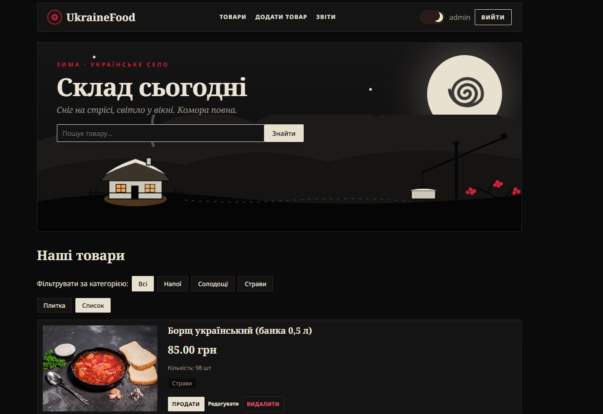
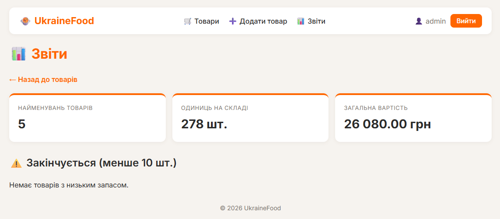
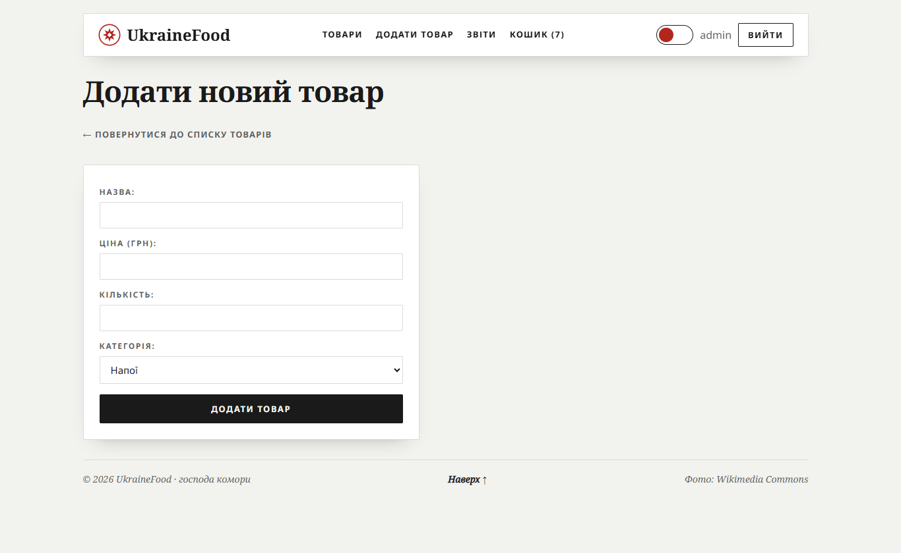
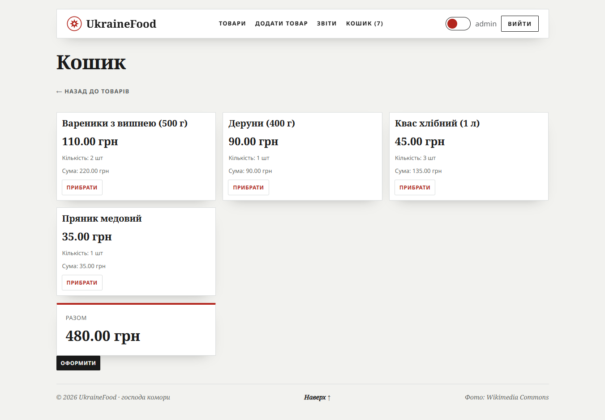
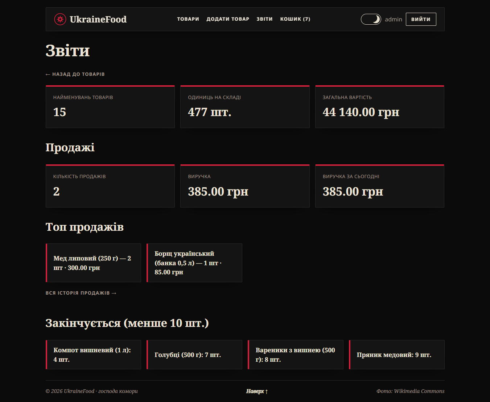
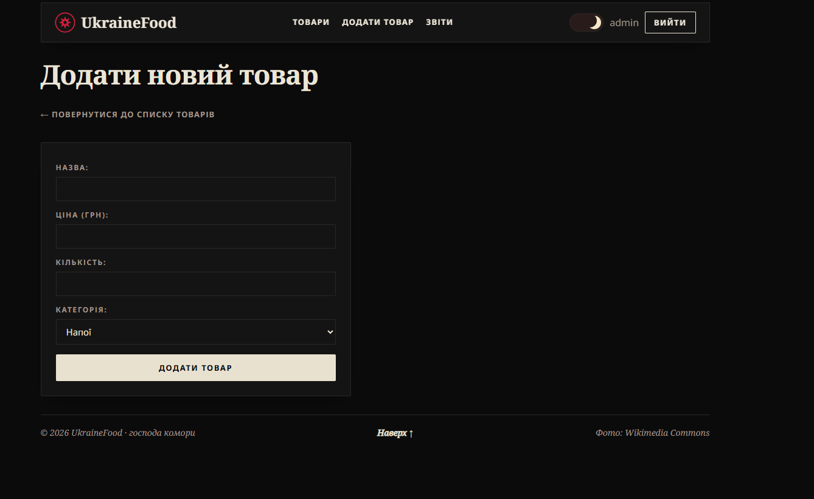
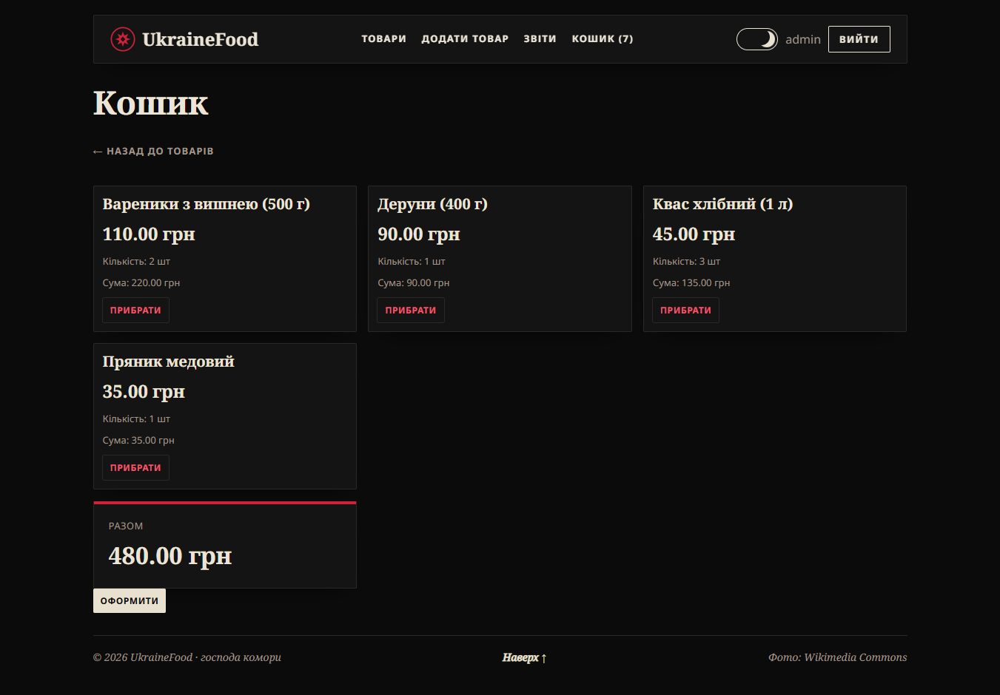
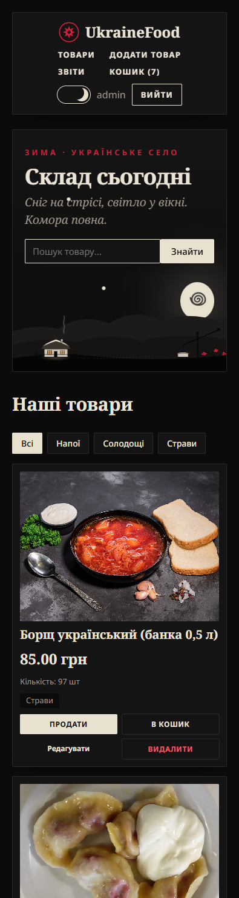

# 🍲 UkraineFood

Адмін-панель для магазину української кухні: облік товарів, продаж і звіти по складу.
Написана на чистому PHP і MySQL, без фреймворків.

🌐 **Демо:** https://ukrainefood.infinityfreeapp.com (логін `admin`, пароль `admin123`)

| День | Ніч |
| --- | --- |
|  |  |

## ✨ Можливості

- 🔐 **Вхід адміністратора** за логіном і паролем
- ➕ **Додавання, редагування й видалення** товарів (CRUD)
- 💰 **Продаж**: кількість на складі зменшується, товар без залишку позначається «Немає в наявності»
- 🔍 **Пошук** за назвою і **фільтр** за категоріями
- 📊 **Звіти**: кількість найменувань, одиниць на складі, загальна вартість складу і товари, що закінчуються
- 🛒 **Кошик** на сесіях: додавання з картки (не більше, ніж є на складі), прибирання, лічильник у шапці; **оформлення однією транзакцією** — або списуються всі товари, або жоден
- 🧾 **Історія продажів**: кожен продаж записується окремо, а назва й ціна фіксуються на момент продажу, тож зміна товару не переписує минулих продажів
- 💵 **Виручка й топ-5** у звітах: кількість продажів, загальна виручка, виручка за сьогодні й найпопулярніші товари
- 🖼️ **Фото товарів**: у кожної картки своє фото, а якщо товару немає в наявності, фото стає чорно-білим (CSS `:has()`)
- 🌗 **Світла й темна тема** з перемикачем; вибір запам'ятовується (`localStorage`), а за замовчуванням береться тема системи
- 🗂️ **Плитка / Список**: у режимі «Список» картка сама перебудовується на «фото зліва, текст справа» через **container queries** (`@container`), а на вузькому екрані лишається вертикальною
- ✨ **Плавні переходи між сторінками** (View Transitions): шапка стоїть на місці, вміст м'яко змінюється
- 📌 **Липка шапка**, кнопка «Наверх» і якорі: після вибору категорії чи пошуку сторінка одразу прокручується до товарів
- 📱 **Адаптивний дизайн**: на телефоні категорії гортаються стрічкою з прилипанням (`scroll-snap`), а меню й кнопки карток стають сіткою 2×2
- ♿ Поважає системне налаштування **«зменшити рух»** (`prefers-reduced-motion`)

## 🛠️ Технології

- **PHP 8** + **PDO**
- **MySQL / MariaDB** (зв'язки між таблицями, зовнішній ключ, `JOIN`, `COUNT`, `SUM`, `GROUP BY`, транзакції)
- **HTML5** (семантичні теги, SVG-ілюстрація в шапці)
- **CSS** без фреймворків: Flexbox, Grid, CSS-змінні, `light-dark()`, CSS nesting, `:has()`, `@container`, View Transitions, `scroll-snap`, `@keyframes`
- **JavaScript** (без бібліотек): перемикач теми й вигляду списку, `localStorage`
- **XAMPP** для локального запуску

## 🛡️ Безпека

- **Prepared statements** (PDO) захищають від SQL-ін'єкцій
- **`htmlspecialchars`** при виводі захищає від XSS
- Паролі зберігаються як хеш (**`password_hash` / `password_verify`**)
- **CSRF-токени** у всіх формах, що змінюють дані
- Дії, що змінюють дані (видалення, продаж, вихід), працюють тільки через **POST**
- **`session_regenerate_id`** після входу захищає від фіксації сесії
- Перевірка даних на сервері (назва, ціна, кількість, категорія)
- Налаштування бази винесені в `config.php`, якого немає в репозиторії

## 📸 Скріншоти

На головній вище — режим **«Список»**: картка сама перебудовується на «фото зліва, текст справа» через `@container`.

|          | Звіти                                       | Додавання товару                        | Кошик                                    |
| -------- | ------------------------------------------- | --------------------------------------- | ---------------------------------------- |
| **День** |            |            |            |
| **Ніч**  |  |  |  |

**Телефон**

 

## 🚀 Як запустити локально

1. Встановіть [XAMPP](https://www.apachefriends.org/) і запустіть **Apache** та **MySQL**.
2. Завантажте проєкт у папку `htdocs`:
   ```
   cd C:\xampp\htdocs
   git clone https://github.com/kuzmenkoi633-alt/ukrainefood.git
   ```
   (або натисніть **Code → Download ZIP** і розпакуйте в `C:\xampp\htdocs\ukrainefood`)
3. Відкрийте **phpMyAdmin** → вкладка **Імпорт** → виберіть файл `database.sql`.
4. Скопіюйте `config.example.php` як `config.php` і впишіть свої дані бази
   (для XAMPP за замовчуванням: користувач `root`, пароль порожній).
5. Відкрийте у браузері: `http://localhost/ukrainefood/`

**Демо-вхід:** логін `admin`, пароль `admin123`

## 📂 Структура

| Файл                                  | Призначення                          |
| ------------------------------------- | ------------------------------------ |
| `index.php`                           | список товарів, пошук, фільтр        |
| `add.php`, `edit.php`                 | додавання й редагування товару       |
| `delete.php`, `sell.php`              | видалення й продаж (POST + CSRF)     |
| `report.php`                          | звіти по складу                      |
| `sales.php`                           | історія продажів                     |
| `cart.php`                            | кошик                                |
| `cart_add.php`, `cart_remove.php`     | додавання й прибирання з кошика      |
| `checkout.php`                        | оформлення кошика однією транзакцією |
| `login.php`, `logout.php`, `auth.php` | вхід, вихід і перевірка авторизації  |
| `functions.php`                       | CSRF-захист і перевірка даних товару |
| `header.php`, `footer.php`            | спільні шапка й футер сторінок       |
| `styles.css`                          | увесь дизайн, світла й темна тема    |
| `theme.js`, `view.js`                 | перемикачі теми й вигляду списку     |
| `db.php`, `config.example.php`        | підключення до бази                  |
| `database.sql`                        | структура бази й демо-дані           |

## 🗺️ Плани

- Пагінація
- Публікація онлайн

Фото товарів: [Wikimedia Commons](https://commons.wikimedia.org/), автори й ліцензії перелічено в [images/CREDITS.md](images/CREDITS.md).

---

Автор: **Ihor Kuzmenko**
