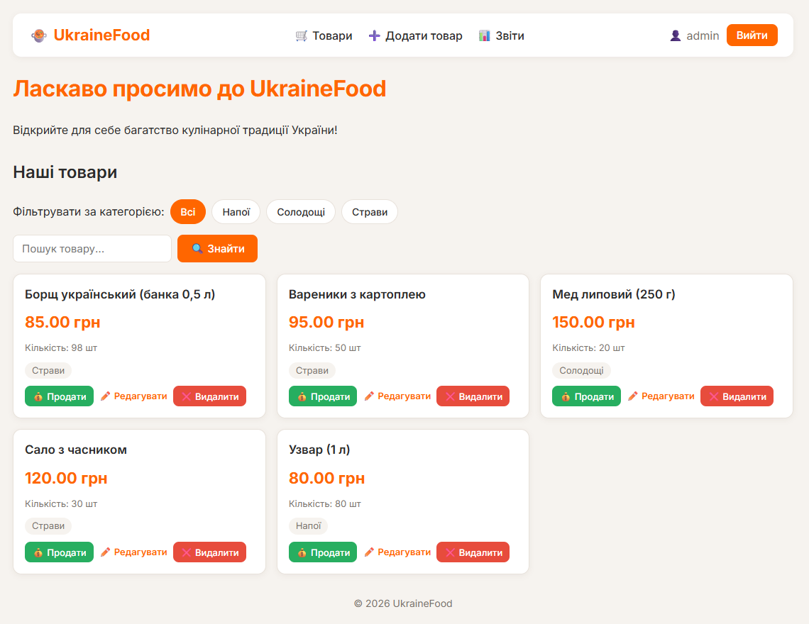
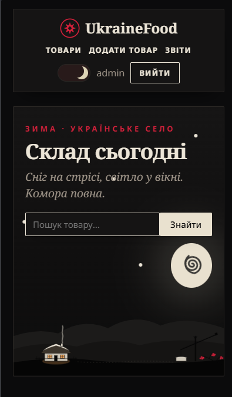

# 🍲 UkraineFood

Адмін-панель для магазину української кухні: облік товарів, продаж і звіти по складу.
Написана на чистому PHP і MySQL, без фреймворків.



## ✨ Можливості

- 🔐 **Вхід адміністратора** за логіном і паролем
- ➕ **Додавання, редагування й видалення** товарів (CRUD)
- 💰 **Продаж**: кількість на складі зменшується, товар без залишку позначається «Немає в наявності»
- 🔍 **Пошук** за назвою і **фільтр** за категоріями
- 📊 **Звіти**: кількість найменувань, одиниць на складі, загальна вартість складу і товари, що закінчуються
- 📱 **Адаптивний дизайн**: працює на комп'ютері й телефоні

## 🛠️ Технології

- **PHP 8** + **PDO**
- **MySQL / MariaDB** (зв'язки між таблицями, зовнішній ключ, `JOIN`, `COUNT`, `SUM`)
- **HTML5** (семантичні теги) і **CSS3** (Flexbox, Grid, CSS-змінні, медіазапити)
- **XAMPP** для локального запуску

## 🛡️ Безпека

- **Prepared statements** (PDO) захищають від SQL-ін'єкцій
- **`htmlspecialchars`** при виводі захищає від XSS
- Паролі зберігаються як хеш (**`password_hash` / `password_verify`**)
- **CSRF-токени** у всіх формах, що змінюють дані
- Дії, що змінюють дані (видалення, продаж, вихід), працюють тільки через **POST**
- **`session_regenerate_id`** після входу захищає від фіксації сесії
- Перевірка даних на сервері (назва, ціна, кількість, категорія)
- Налаштування бази винесені в `config.php`, якого немає в репозиторії

## 📸 Скріншоти

| Звіти | Додавання товару | Телефон |
|---|---|---|
|  |  |  |

## 🚀 Як запустити локально

1. Встановіть [XAMPP](https://www.apachefriends.org/) і запустіть **Apache** та **MySQL**.
2. Завантажте проєкт у папку `htdocs`:
   ```
   cd C:\xampp\htdocs
   git clone https://github.com/kuzmenkoi633-alt/ukrainefood.git
   ```
   (або натисніть **Code → Download ZIP** і розпакуйте в `C:\xampp\htdocs\ukrainefood`)
3. Відкрийте **phpMyAdmin** → вкладка **Імпорт** → виберіть файл `database.sql`.
4. Скопіюйте `config.example.php` як `config.php` і впишіть свої дані бази
   (для XAMPP за замовчуванням: користувач `root`, пароль порожній).
5. Відкрийте у браузері: `http://localhost/ukrainefood/`

**Демо-вхід:** логін `admin`, пароль `admin123`

## 📂 Структура

| Файл | Призначення |
|---|---|
| `index.php` | список товарів, пошук, фільтр |
| `add.php`, `edit.php` | додавання й редагування товару |
| `delete.php`, `sell.php` | видалення й продаж (POST + CSRF) |
| `report.php` | звіти по складу |
| `login.php`, `logout.php`, `auth.php` | вхід, вихід і перевірка авторизації |
| `functions.php` | CSRF-захист і перевірка даних товару |
| `header.php`, `footer.php` | спільні шапка й футер сторінок |
| `db.php`, `config.example.php` | підключення до бази |
| `database.sql` | структура бази й демо-дані |

## 🗺️ Плани

- Історія продажів
- Корзина й оформлення замовлень для покупців
- Фото товарів
- Пагінація

---

Автор: **Ihor Kuzmenko**
